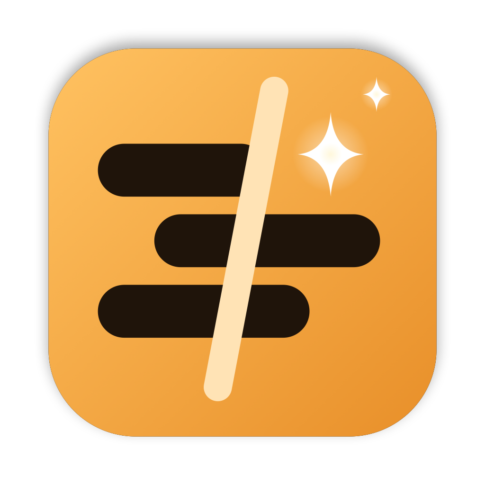

<p align="center"></p>

<h1 align="center">Cutgenie</h1>

<p align="center"><strong>Your editing genie.</strong> A native macOS video editor that you can drive by hand <em>or</em> by an AI assistant.<br>
Built by Vishal Pratap · <a href="https://techzonical.in">TechZonical</a></p>

---

Cutgenie is a timeline video editor written in Swift (SwiftUI + AVFoundation + Core Image). It was built for real
YouTube work: long talking-head videos with B-roll, motion graphics, colour grading and clean sound. Everything you can do
with the mouse can also be done through a small local control interface (`cutgeniectl`), so an AI assistant or a script
can make the edits for you and you can check and adjust them by hand.

## Features

- **Timeline:** magnetic main track, any number of video / graphics / sound tracks, blade, trim, roll, slip, slide,
  ripple delete, groups, markers, snapping, linked sound, sync by sound.
- **Picture:** position, scale, rotation, opacity, crop, drop shadow and zoom for every clip, with keyframes, easing
  presets, a bezier **graph editor**, and on-screen handles.
- **Colour:** exposure / contrast / saturation / temperature, colour wheels, LUTs (input and look), HLG / log / Rec.709
  handling, copy and paste grade, saved looks.
- **Graphics:** text layers, shapes (rectangle, circle, line, gradient, blur / pixelate areas), builds in and out,
  behaviours, masks, an effect stack, saved titles and presets.
- **Sound:** per-clip volume with keyframes, fades, EQ, compressor, gate, limiter, loudness measuring (LUFS), presets.
- **Project safety:** autosave every minute, crash recovery, the last 10 versions of every project, atomic saves,
  missing-media relink, collect media.
- **Export:** presets for YouTube (HEVC), *Smart size* (constant-quality HEVC, about a third of the usual file size),
  H.264, ProRes masters and sound only; exports run in the background.
- **Import:** Final Cut Pro XML (`.fcpxml`).

## Requirements

- macOS 14 (Sonoma) or later, Apple Silicon recommended
- Xcode 15+ command line tools (`xcode-select --install`), including the Metal toolchain (`xcrun metal`)
- [ffmpeg](https://ffmpeg.org) on your PATH (`brew install ffmpeg`): used by the build for a tiny filler clip and by the tests

## Build and run

```bash
git clone https://github.com/<you>/cutgenie.git
cd cutgenie
zsh scripts/build_app.sh          # builds build/Cutgenie.app and build/cutgeniectl
open build/Cutgenie.app
```

`swift build -c release` alone builds the binaries; `scripts/build_app.sh` wraps them into a proper `.app` with the
Metal colour kernels and the icon. `scripts/install.sh` copies the app to `/Applications` and makes a `.dmg`.

## Driving it from a script or an AI assistant

While the app runs it listens on `127.0.0.1:7878` (local only; set `CUTGENIE_PORT` to change it). `cutgeniectl`
sends one command and prints the JSON reply:

```bash
build/cutgeniectl open path=~/Movies/my-video.cutgenie.json
build/cutgeniectl split at=12.5
build/cutgeniectl set_color clip=c3 exposure=0.2 saturation=1.1
build/cutgeniectl export out=~/Desktop/test.mp4 codec=hevc mbps=12 from=0 to=30
build/cutgeniectl quit save=true
```

There are about 150 commands; see [docs/CONTROL.md](docs/CONTROL.md).

## Tests

```bash
swift build -c release && python3 tests/smoke.py      # 30 seconds, no footage needed
```

The full suite (`tests/check_all.py`) and the long-session test (`tests/long_run.py`) run on your own footage; see
[docs/TESTING.md](docs/TESTING.md).

## Project layout

```
Sources/CutgenieCore   the engine: project model, editing commands, rendering, colour, sound, export (no UI)
Sources/Cutgenie       the macOS app: SwiftUI windows, timeline, viewer, inspectors
Sources/cutgeniectl    the command-line tool that talks to a running app
scripts/                 build, install and icon scripts
tests/                   smoke test, full check suite, long-session test
docs/                    architecture, control commands, project format, testing
```

More in [docs/ARCHITECTURE.md](docs/ARCHITECTURE.md).

## Who made it

Cutgenie is built by **Vishal Pratap**, creator of the [TechZonical](https://techzonical.in) YouTube channel, as the
editor he uses for his own videos. It was developed with the help of Claude (Anthropic's AI assistant), which is also
why everything in the app can be driven through `cutgeniectl`.

## Contributing

Issues and pull requests are welcome; please read [CONTRIBUTING.md](CONTRIBUTING.md) first.

## License

Copyright (C) 2026 Vishal Pratap (TechZonical).

Cutgenie is free software: you can redistribute it and/or modify it under the terms of the GNU General Public License
version 3 as published by the Free Software Foundation. It is distributed in the hope that it will be useful, but
WITHOUT ANY WARRANTY. See [LICENSE](LICENSE) for the full text.

"Cutgenie" and the Cutgenie icon are names and marks of TechZonical. Cutgenie is an independent project and is not
affiliated with Apple, Adobe or Anthropic.
