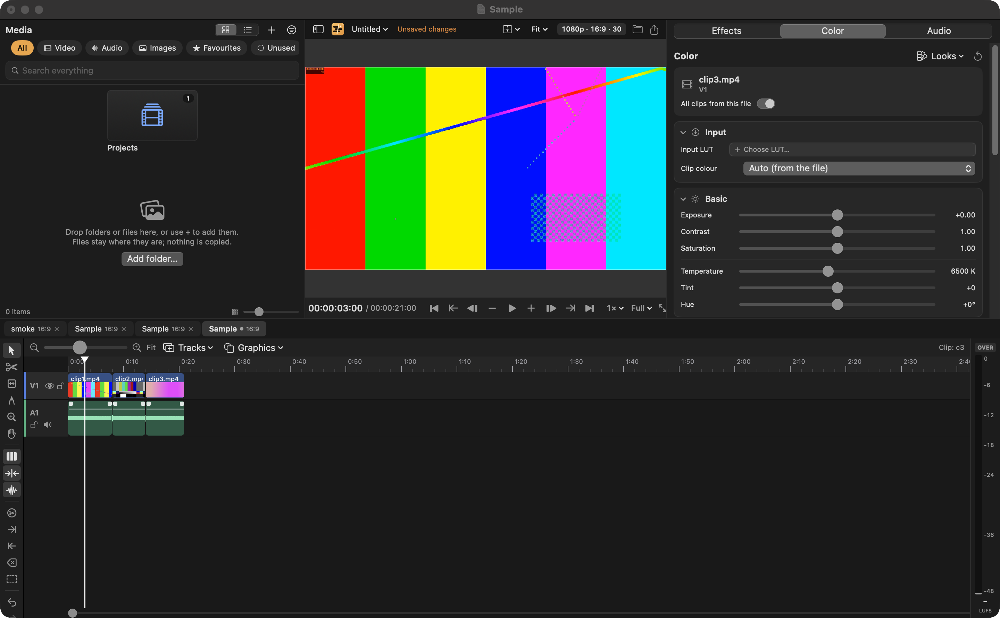

# What is Cutgenie?

Cutgenie is a **video editor** for the Mac. A video editor is an app where you put your recordings in order, cut out
the bits you don't want, and add things like titles, music and colour. When you are happy, you **export** the result:
Cutgenie turns your edit into one finished video file you can upload to YouTube or share.

## What makes it different

- **It's free and open source.** Anyone can use it and read how it works.
- **You can edit by hand.** Drag clips, cut them, add text: the usual way.
- **Or ask an AI to help.** Cutgenie can take instructions from Claude, an AI assistant. You can type something like
  *"cut the silent pauses out of my video"* and then check and adjust the result yourself. You will learn this in the
  *Editing with Claude* chapter.
- **It keeps your work safe.** It saves on its own every minute and keeps your last 10 versions of every project.
- **It never changes your original recordings.** Your edits only live in the project, so the files from your camera
  stay exactly as they were.

## Words you will see a lot

| Word | What it means |
|---|---|
| **Clip** | One piece of video, sound or a picture in your edit. |
| **Project** | Your edit: which clips, in what order, with which changes. Saved as one small file. |
| **Timeline** | The long strip at the bottom of the window where you arrange clips from left (start) to right (end). |
| **Export** | Turning your project into a finished video file. |

## Next

[What you need →](02-requirements.mdx)
