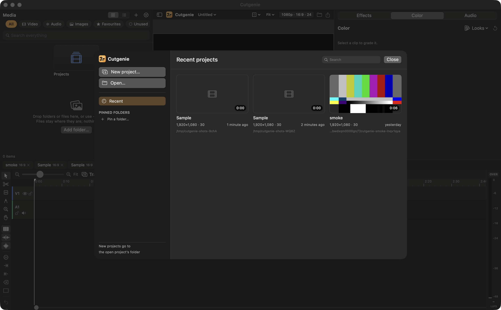
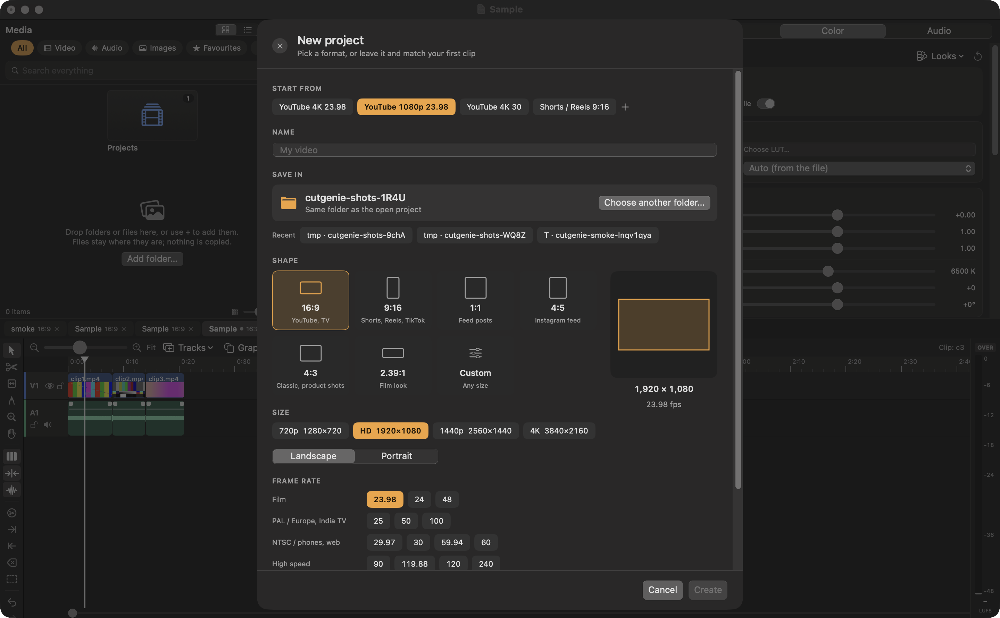
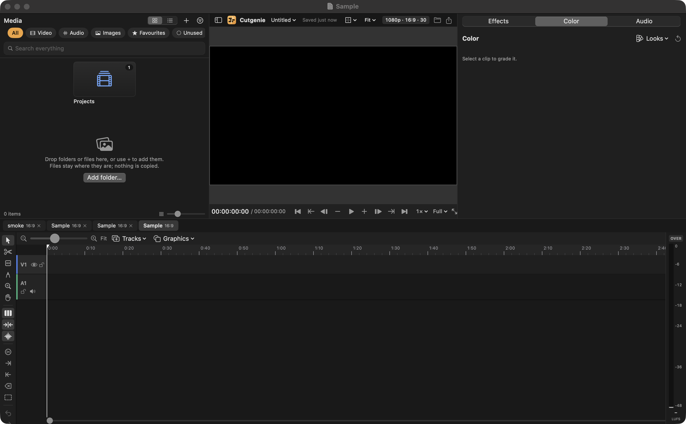

# Open it for the first time

## 1. Open the app

Open your **Applications** folder and double-click **Cutgenie**.

## 2. If macOS says it can't check the app

Early versions of Cutgenie are not yet checked ("notarised") by Apple, so the first time macOS may show a message
like *"Apple could not verify Cutgenie is free of malware"*. This is normal for new free apps. To allow it:

1. Click **Done** (or **OK**) to close the message.
2. Open **System Settings** (Apple menu  ▸ System Settings) and click **Privacy & Security** in the sidebar.
3. Scroll down to the **Security** part. You'll see a line about Cutgenie. Click **Open Anyway**.
4. Type your Mac password or use Touch ID if asked, then click **Open Anyway** again.

You only do this once. After that Cutgenie opens normally.

## 3. The start window

When Cutgenie opens you see the **project browser**. On the left are **New project…** and **Open…**; on the right are
your recent projects (empty the first time).

## 4. Make your first project

Click **New project…**. A window asks what kind of video you are making.

- Pick a ready-made choice at the top, such as **YouTube 1080p**. If you're not sure, that one is a good start.
- **16:9** is the wide shape of YouTube and TVs; **9:16** is the tall shape for Shorts, Reels and TikTok.
- Choose where to save the project, give it a name, and click **Create**.

You now have an empty project, ready for your clips:

The next chapter, *The interface*, explains every part of this window. To bring in your recordings, see *Importing*.

## Next

[Update to a new version →](05-updating.mdx)
