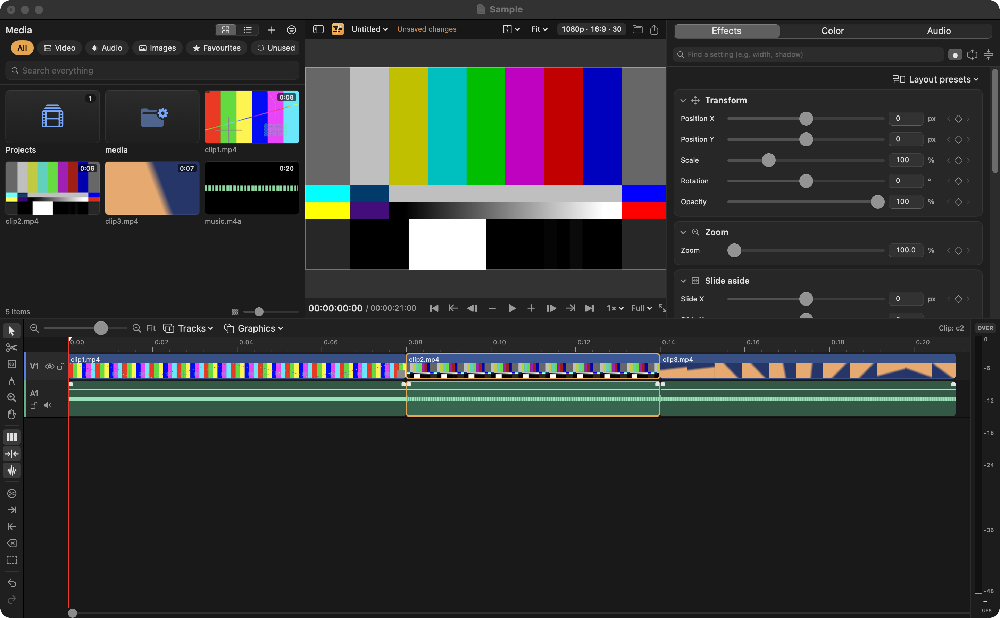

# A tour of the window

Cutgenie has one main window with four parts. Once you know them, every other page in this guide makes sense.

| Part | Where | What it's for |
|---|---|---|
| **Media panel** | Top left | Your recordings, music and pictures, ready to use. |
| **Viewer** | Top middle | Shows the video at the **playhead** (the white line on the timeline). |
| **Inspector** | Top right | Settings for whatever you selected: size, colour, sound. |
| **Timeline** | Bottom | Your edit. Clips play from left to right. |

Along the left edge of the timeline is a narrow column of **tools** (select, blade, trim and more).

You don't need to learn it all now. Each part has its own page in this chapter.

## Next

[The media panel →](02-media-panel.mdx)
