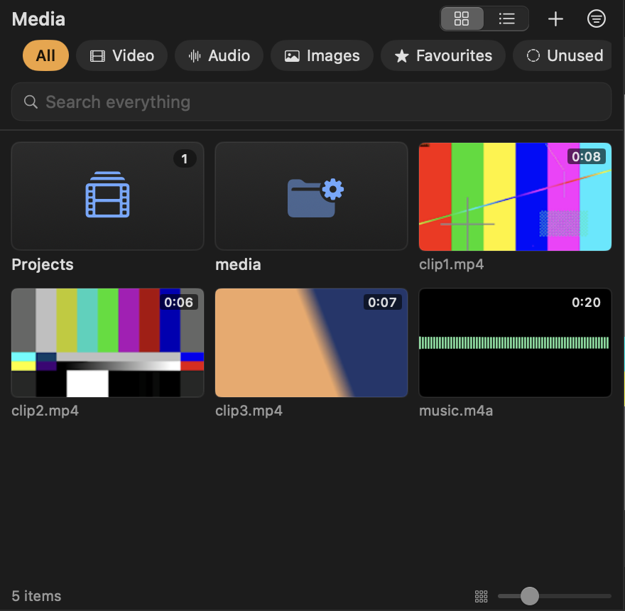

# The media panel

The **media panel** is your box of ingredients: every video, sound and picture you've added to Cutgenie.

- **Thumbnails or list.** The two buttons at the top switch between pictures and a list with details.
- **Skim.** In thumbnail view, move the pointer across a clip to preview it without playing.
- **Filters.** *All*, *Video*, *Audio*, *Images*, *Favourites* and *Unused* show just that kind of clip.
  *Unused* means clips you haven't put in this project yet.
- **Search everything.** Type part of a file name, a keyword or a note.
- **+ button.** Adds files or folders. See [Import clips](../04-importing/01-import-clips.mdx).
- **Projects** (the first tile) lists the projects in the same folder.

Show or hide the panel with **⌘1** or the sidebar button at the top of the viewer.

> Your files are **not copied** into Cutgenie. The media panel only remembers where they are on your Mac.

## Next

[The viewer →](03-viewer.mdx)
