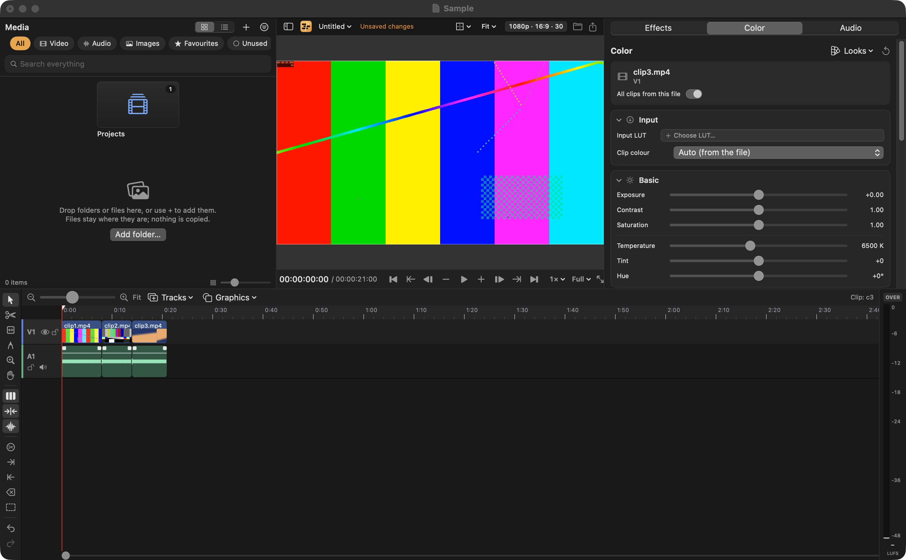

# The viewer

The **viewer** shows the picture at the playhead. When you play, it plays your edit.

**Above the picture**
- The **project name** (click it for a menu: rename, versions and more; see the *Projects* chapter).
- **Saved just now** / **Unsaved changes** tells you whether your latest change is saved.
- **Fit** sets the viewer zoom. Pinch or ⌘-scroll over the picture to zoom in.
- The **format** button (for example `1080p · 16:9 · 30`) opens the project settings (**⌘J**).
- The folder button opens another project; the share button exports (**⌘E**).

**Below the picture**
- The **time**: where the playhead is / how long the whole edit is, as hours:minutes:seconds:frames.
- **Play buttons**: go to start, previous edit, one frame back, play, one frame forward, next edit, end.
- **1×** changes the playback speed in the viewer only.
- **Full / ½ / ¼** is the playback quality. Lower is easier on an older Mac. Your export is always full quality.
- The arrows on the far right play full screen (**⇧⌘F**). Press **Esc** to come back.

## Next

[Inspector: Effects →](04-inspector-effects.mdx)
