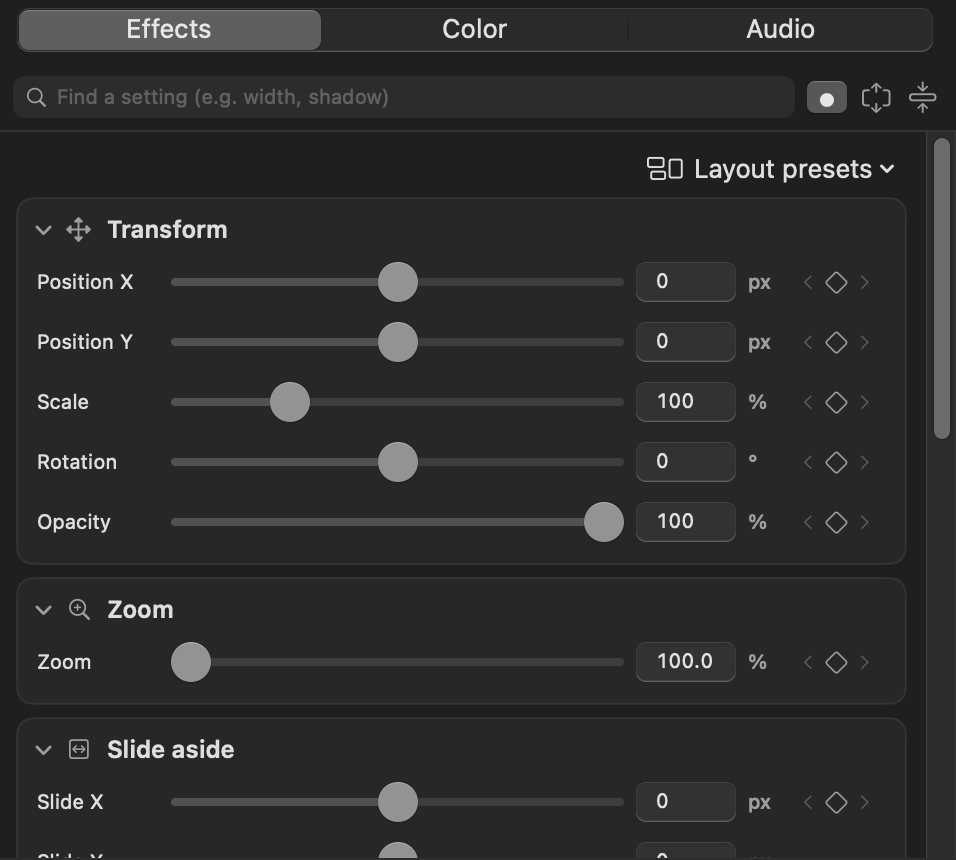

# Inspector: Effects

The **inspector** is the column on the right. It changes the clip you have **selected** (clicked on in the timeline,
shown with an orange outline). It has three tabs: **Effects**, **Color** and **Audio**.

The **Effects** tab changes how the clip looks in the frame.

- **Transform**: move (Position X and Y), resize (Scale), turn (Rotation) and fade (Opacity) the clip.
- **Zoom**: push in on the picture.
- **Slide aside**, **Crop**, **Drop shadow** and more further down.
- **Find a setting** searches every setting by name, for example *shadow*.
- The small ◇ diamond next to a setting adds a **keyframe**, a point where a value changes over time.
  The *Picture* chapter explains keyframes.

Every slider has a box with its exact number. Click the box to type a value.

## Next

[Inspector: Color →](05-inspector-colour.mdx)
