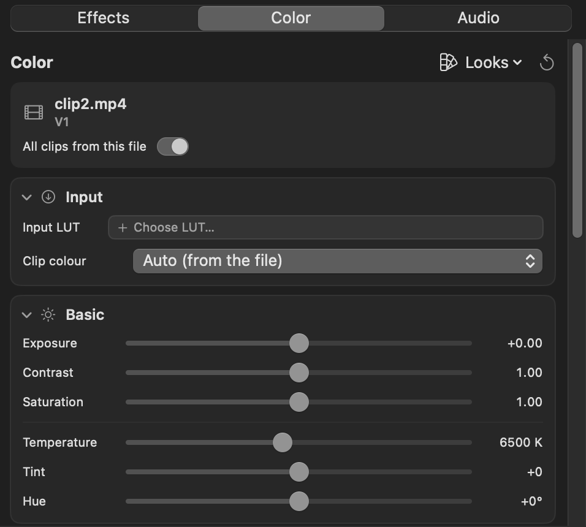

# Inspector: Color

The **Color** tab changes the colours and brightness of the selected clip. This is called **colour grading**.

- **Input**: tells Cutgenie what kind of colour your camera recorded. *Auto (from the file)* is right for most clips.
- **Basic**: Exposure (brightness), Contrast, Saturation (how strong colours are), Temperature (warm or cool),
  Tint and Hue.
- **Looks** (top right) saves a grade so you can use it again.
- The ↺ arrow resets the grade.
- **All clips from this file** grades every piece cut from the same recording in one go.

The *Colour* chapter covers all of this step by step.

## Next

[Inspector: Audio →](06-inspector-audio.mdx)
