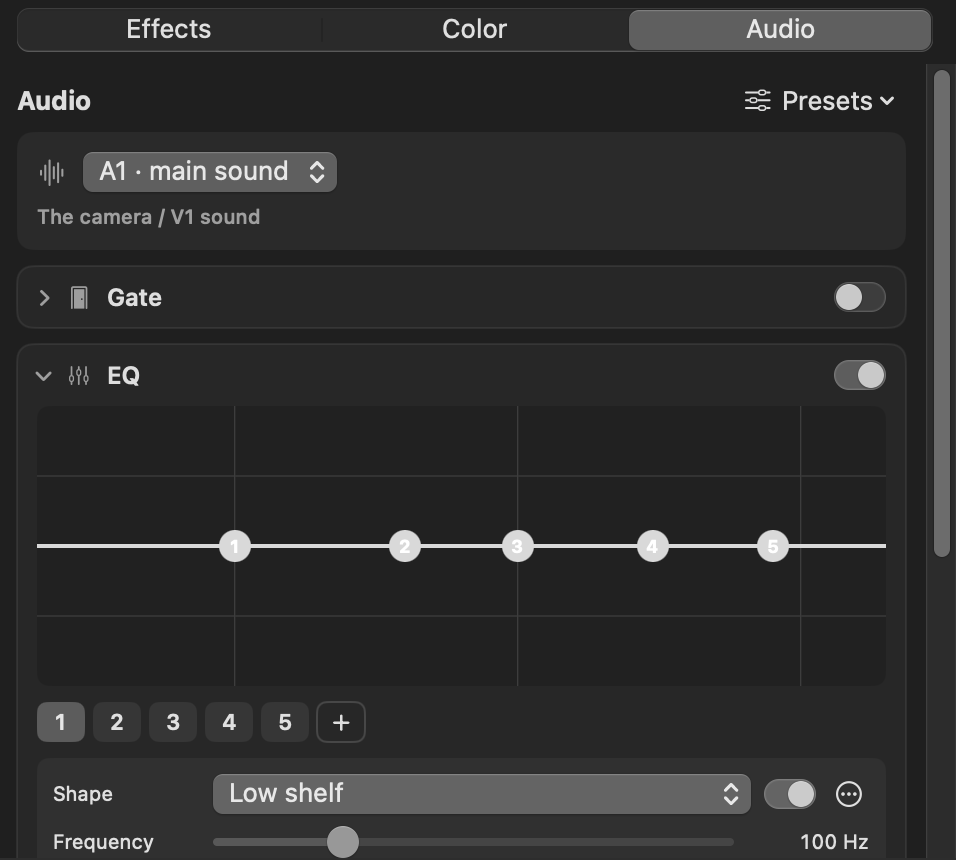

# Inspector: Audio

The **Audio** tab works on a whole **sound track** (such as A1, the camera sound), not one clip.

- The menu at the top picks the track, for example **A1 · main sound**.
- **Gate** hides quiet background noise between words.
- **EQ** makes the voice warmer, clearer or less boomy.
- **Compressor** evens out loud and quiet parts.
- **Loudness** and **Output** set the final volume.
- **Presets** saves your settings to reuse in other videos.

Each part has a switch on the right to turn it on or off. The *Sound* chapter explains each one.

> Want to change the volume of one clip instead? Select it and use the **Volume** section in the **Effects** tab.

## Next

[The timeline and tracks →](07-timeline.mdx)
