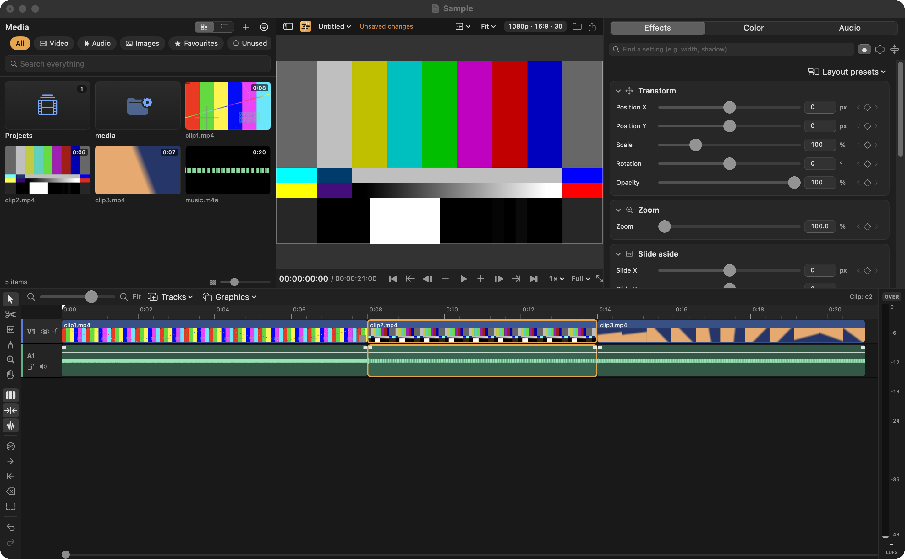

# The timeline and tracks

The **timeline** is where you build your video. Time runs from left to right.

- **Ruler**: the numbers along the top are minutes and seconds.
- **Playhead**: the white line. The viewer shows the frame under it. Click the ruler to move it.
- **Tracks**: the rows. **V1** is the main video track; **A1** is its sound. Tracks above V1 (V2, V3…) hold things
  shown *on top*, such as titles or a picture-in-picture.
- Each track has an **eye** (show/hide), a **lock** and, for sound, a **speaker** (mute).
- **Clips**: the coloured blocks. Blue is video, green is sound, and an orange outline means selected.
- **Meter**: the column on the far right shows how loud the sound is while playing.

**Getting around**
- Zoom with the slider at the top, **⌘+** / **⌘−**, or pinch on a trackpad.
- **Fit** (or **⇧Z**) shows the whole edit.
- **Tracks** adds tracks or music; **Graphics** adds text, shapes and blur areas.

## Next

[The tools →](08-tools.mdx)
