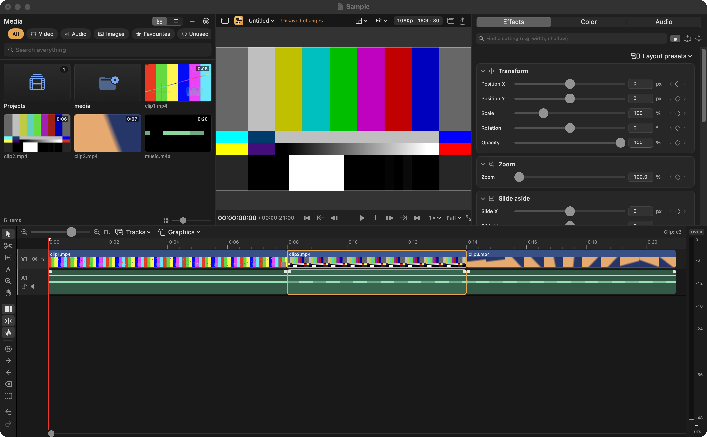

# The tools

The narrow column on the left of the timeline holds the **tools**. The chosen tool is highlighted. Each one has a
single-letter key.

**Pointer tools** (what a click on the timeline does)

| Tool | Key | What it does |
|---|---|---|
| Select | **A** | Click to select, drag to move. The normal tool. |
| Blade | **B** | Click a clip to cut it in two there. |
| Trim | **T** | Drag where two clips meet to change both at once. |
| Pen | **P** | Click a sound clip's volume line to add volume points. |
| Zoom | **Z** | Click to zoom in on the timeline. |
| Hand | **H** | Drag to scroll around the timeline. |

**Switches**

| Switch | Key | What it does |
|---|---|---|
| Magnetic timeline | **⌥P** | Clips on V1 close up gaps automatically. |
| Snapping | **N** | Clips jump neatly to edges and the playhead. |
| Skimming | **S** | Moving the pointer over the timeline previews that spot. |

**Quick actions** further down: cut at playhead (**⌘B**), trim start/end to the playhead (**⌥[** / **⌥]**),
delete (**⌫**), delete and leave a gap (**⇧⌫**), undo (**⌘Z**) and redo (**⇧⌘Z**).

Point at any button for a second to see its name and key.

## Next

[Change the layout →](09-layout.mdx)
