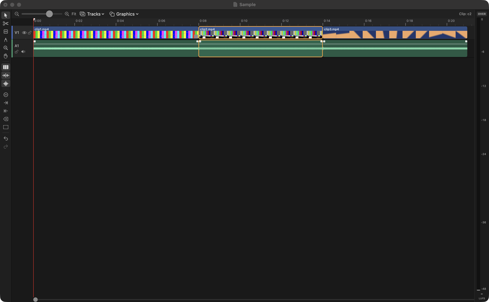

# Change the layout

You can arrange the window to suit what you're doing.

- **Hide the media panel**: **⌘1**. Press again to show it.
- **Bigger timeline**: **⇧⌘T** gives the timeline most of the window, handy for long edits. Press again to go back.
- **Bigger viewer**: **⌥⇧⌘F**.
- **Full screen playback**: **⇧⌘F**, then **Esc**.
- **Resize a part**: drag the thin line between two parts.

All of these are also in the **View** menu at the top of the screen.
