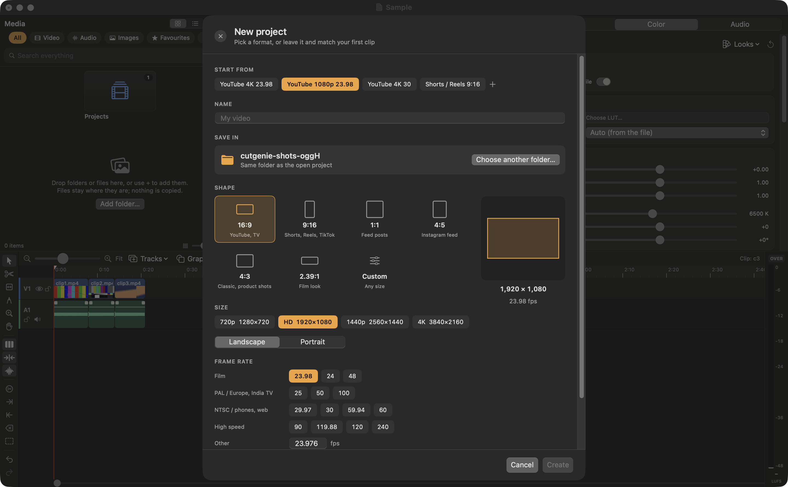

# Make a new project

A **project** is one edit: which clips you use, in what order, with which changes. It's saved as one small file
ending in `.cutgenie.json`. Your video files are **not** inside it; the project only points to them.

1. Choose **File ▸ New project…** (**⌘N**).
2. Pick a format (see [Choose a format](02-formats.mdx)).
3. Type a **name** and choose a **folder**.
4. Click **Create**.

> **Tip:** keep each video in its own folder, with the project file next to its recordings. Moving or backing up
> the folder then keeps everything together.

## Next

[Choose a format →](02-formats.mdx)
