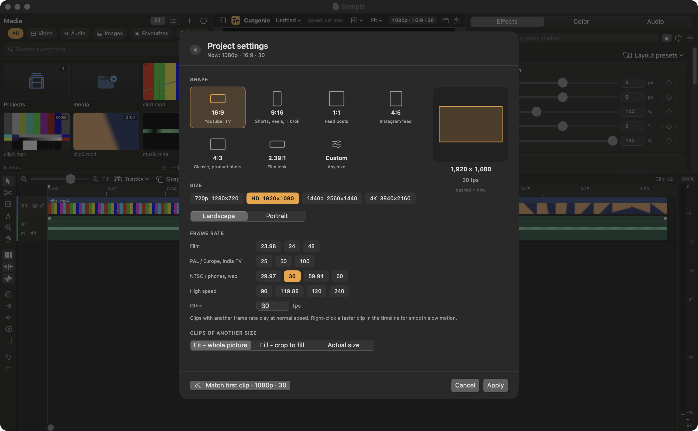

# Choose a format

The **format** is the shape and size of your finished video.

- **Shape (aspect ratio)**: **16:9** is wide (YouTube, TV). **9:16** is tall (Shorts, Reels, TikTok).
  **1:1** is square, **4:5** suits Instagram posts.
- **Size (resolution)**: how many pixels wide and tall. **HD 1920×1080** is a safe choice; **4K 3840×2160** is
  sharper but needs more space and a faster Mac.
- **Frame rate**: how many pictures per second. Use the same number your camera recorded (often 24, 25, 30 or 60).
  If you're unsure, check one clip: the media panel's list view shows it.

The buttons at the top, such as **YouTube 1080p**, set all three at once.

## Change it later

Click the format button above the viewer (for example `1080p · 16:9 · 30`) or press **⌘J**.

Click **Save the format as your own template** (the button next to the presets) to reuse it for new projects.

## Next

[Open, switch and close projects →](03-open-switch-close.mdx)
