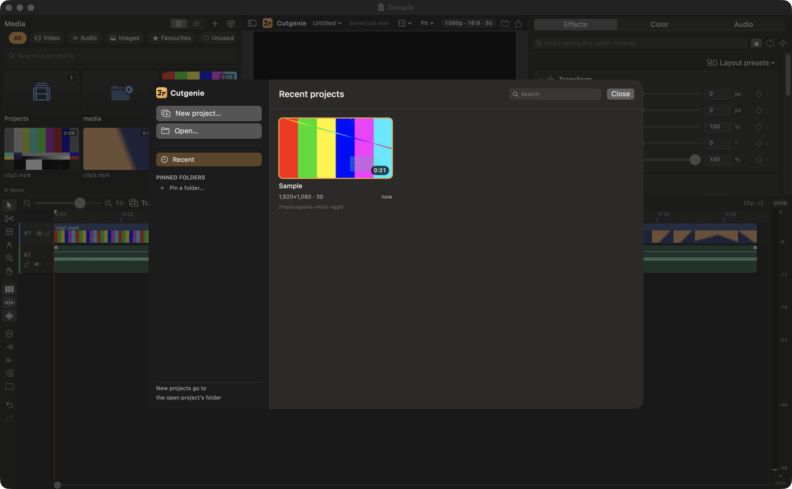

# The project browser

The **project browser** shows all your recent projects with a picture, size and when you last changed them.
Open it with **File ▸ All projects…** (**⇧⌘O**).

- **Recent** lists the projects you opened lately. Double-click one to open it.
- **Search** (top right) finds a project by name.
- **Pin a folder…** adds a folder to the left side, so all projects in it are one click away. Good for a
  "YouTube videos" folder.
- **New project…** and **Open…** are at the top left.
- Press **Esc** or **Close** to go back to your edit.

## Next

[Rename, move or duplicate a project →](05-rename-move-duplicate.mdx)
