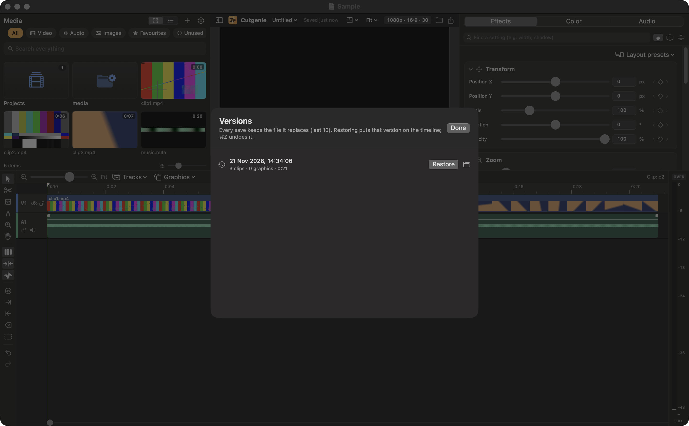

# Go back to an earlier version

Every time you save, Cutgenie keeps the copy it replaces. The **last 10 versions** of each project are kept.

1. Click the project name above the viewer and choose **Versions…**.
2. Each line shows when it was saved and how many clips it had.
3. Click **Restore** next to the one you want.

Restoring puts that version on the timeline. Changed your mind? Press **⌘Z** to undo the restore.

## Next

[Autosave and crash recovery →](07-autosave-recovery.mdx)
