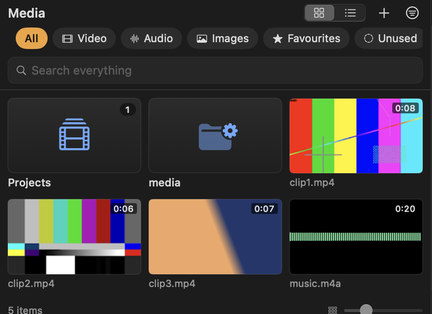

# Import clips

**Importing** means telling Cutgenie about your files so you can use them. Nothing is copied: the files stay where
they are.

**Three ways to import**
- Click **+** at the top of the media panel and choose **Add files…** or **Add folder…**.
- Drag files or a folder from Finder onto the media panel.
- Drag a file straight onto the timeline to import and use it in one go.

Adding a folder adds everything inside it. It shows as a folder tile you can double-click to open.

**Put a clip on the timeline**: select it, then press **E** to add it at the end, or right-click it for more
choices. See [Add clips to the timeline](../05-editing-basics/01-append-insert.mdx).

## Next

[Which files work →](02-formats.mdx)
