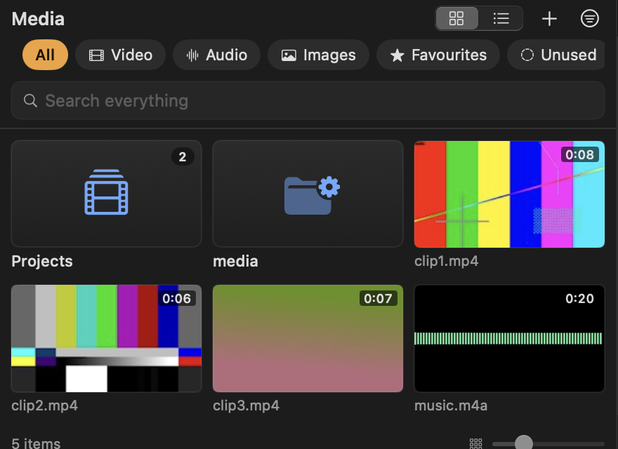

# Which files work

Cutgenie uses the Mac's own video engine, so it opens what your Mac can play.

| Kind | Common file types |
|---|---|
| Video | `.mp4`, `.mov`, `.m4v` in H.264, HEVC (H.265) or ProRes |
| Sound | `.m4a`, `.mp3`, `.wav`, `.aif`, `.aac` |
| Pictures | `.png`, `.jpg`, `.heic`, `.tiff` |

iPhone, most mirrorless cameras, screen recordings and OBS recordings (saved as MP4 or MOV) all work.

HDR and log footage from cameras such as iPhone (HLG or Dolby Vision) or Sony (S-Log) works too. The *Colour* chapter
explains how to make it look right.

If a file won't import, it's probably in a format macOS can't play, such as some `.mkv` or `.avi` files.
Re-save it as MP4 first (for example from the app that recorded it).

## Next

[Organise your media →](03-organise-media.mdx)
