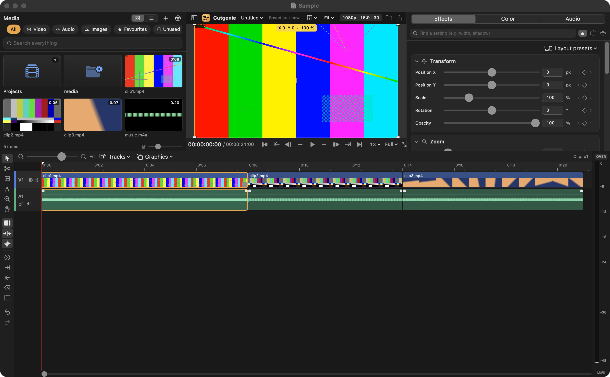

# Play and move around

| Key | What it does |
|---|---|
| **Space** | Play / pause |
| **J** / **K** / **L** | Play backwards / stop / play forwards. |
| **←** / **→** | One frame back / forward |
| **⇧←** / **⇧→** | Ten frames back / forward |
| **↑** / **↓** | Jump to the previous / next cut |
| **Home** / **End** | Go to the start / end |

- **Click the ruler** to move the playhead there.
- **Skimming** (**S**): move the pointer over the timeline and the viewer shows that spot without moving the
  playhead.

## Next

[Cut a clip in two →](04-blade.mdx)
