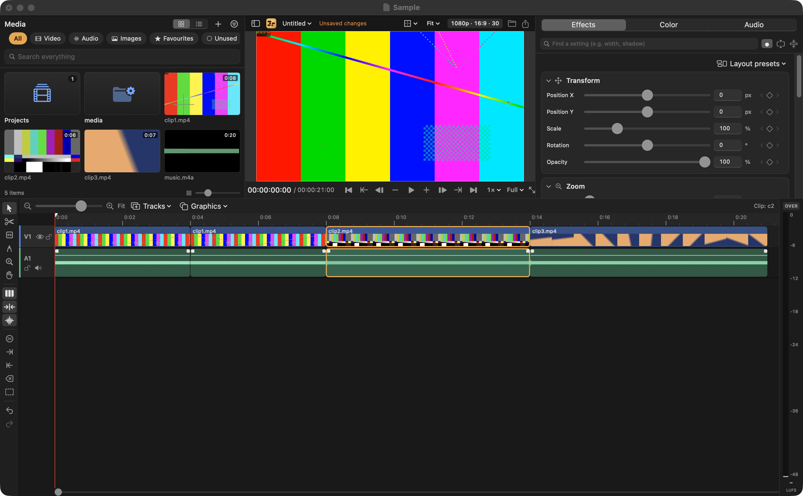

# Cut a clip in two

To remove a bit from the middle of a clip, first cut it into pieces. This is called **blading**.

**At the playhead** (quickest)
1. Move the playhead to where you want the cut.
2. Press **⌘B**. The clip under the playhead is split there.

**With the Blade tool**
1. Press **B** (the pointer becomes scissors).
2. Click a clip where you want to cut. Press **A** to go back to the normal pointer.

**⇧⌘B** cuts every track at the playhead at once (video, titles and music together).

Cutting doesn't remove anything yet. See [Delete parts](07-delete.mdx).

## Next

[Trim the start or end of a clip →](05-trim.mdx)
