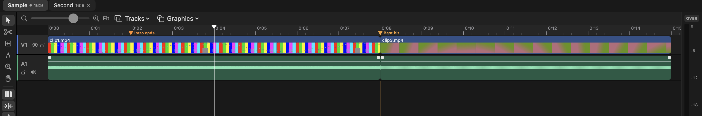
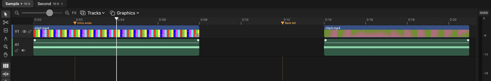

# Delete: close the gap or leave it

Select a clip (or a piece you cut with the blade), then:

| Key | Name | What happens |
|---|---|---|
| **⌫** | Delete (ripple) | The clip goes **and later clips slide left** to fill the space. |
| **⇧⌫** | Delete, leave gap | The clip goes and an **empty gap** stays, so later clips don't move. |

Use **⌫** to remove mistakes and pauses in a talk. Use **⇧⌫** when the timing of everything after must stay the same,
for example when music is already lined up.

Deleting from the timeline never deletes your file. It's still in the media panel.

## Next

[Undo and redo →](08-undo.mdx)
