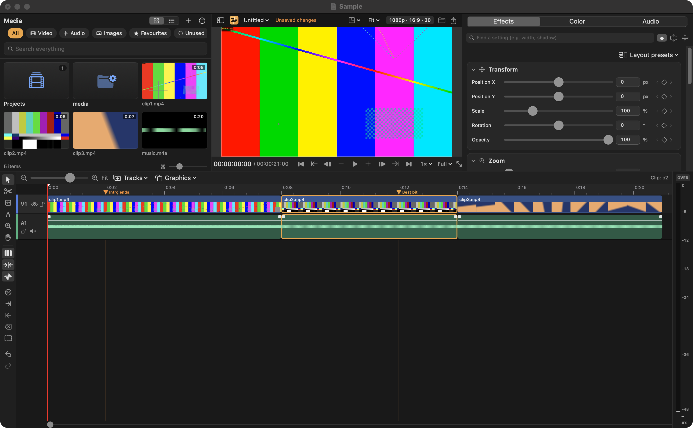

# Markers

A **marker** is a little flag on the ruler, like a bookmark.

- **Add**: press **M**. It's added at the pointer if you're skimming, otherwise at the playhead.
- **Add with a name**: **⌥M**.
- **Rename**: double-click the marker.
- **Jump**: **⌃'** to the next marker, **⌃;** to the previous one.
- **Move**: drag it along the ruler. **Delete**: select it and press **⌫**.

Use markers for "fix the colour here", "music starts" or chapter points for YouTube.

## Next

[Groups and linked sound →](10-groups-linking.mdx)
