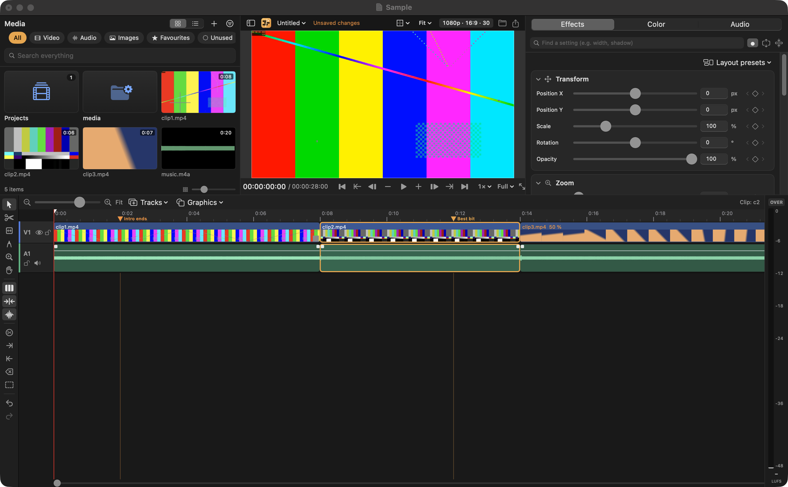

# Speed and slow motion

1. Right-click a clip on the timeline.
2. Choose **Speed** and a value: **25 %** (very slow), **50 %**, **75 %**, **Normal (100 %)**, **125 %**, **150 %**,
   **200 %** or **400 %** (very fast).

The clip gets longer or shorter and shows its speed next to its name.

For any other value, select the clip and use **Speed** in the **Effects** tab of the inspector.

**Smooth slow motion**: if you filmed at a high frame rate (for example 60 or 120 frames per second) in a 30 fps
project, right-click the clip and choose **Use for slow motion**. Cutgenie plays every recorded frame, so it's
smooth instead of jerky.

Back to normal: **Speed ▸ Normal (100 %)**.
