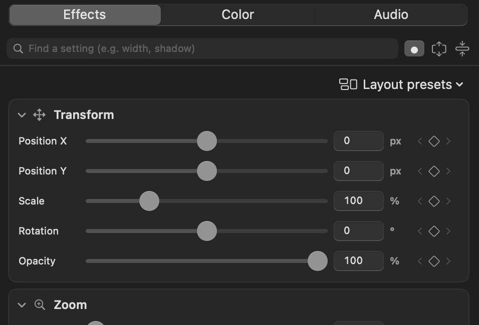

# Move, resize and turn a clip

**Transform** changes where a clip sits in the frame and how big it is.

1. Click a clip on the timeline to select it.
2. Open the **Effects** tab in the inspector.
3. In **Transform**, drag a slider or click its number box and type a value:
   - **Position** X and Y move the picture left, right, up and down.
   - **Scale** makes it bigger or smaller.
   - **Rotation** turns it.
   - **Opacity** makes it see-through. 0 is invisible, 100 is solid.

You can also drag the picture straight in the viewer. Drag the corner handles to resize it.

To go back to the original, click the reset arrow on the right of the **Transform** title.

## Next

[Zoom in on the picture →](02-zoom.mdx)
