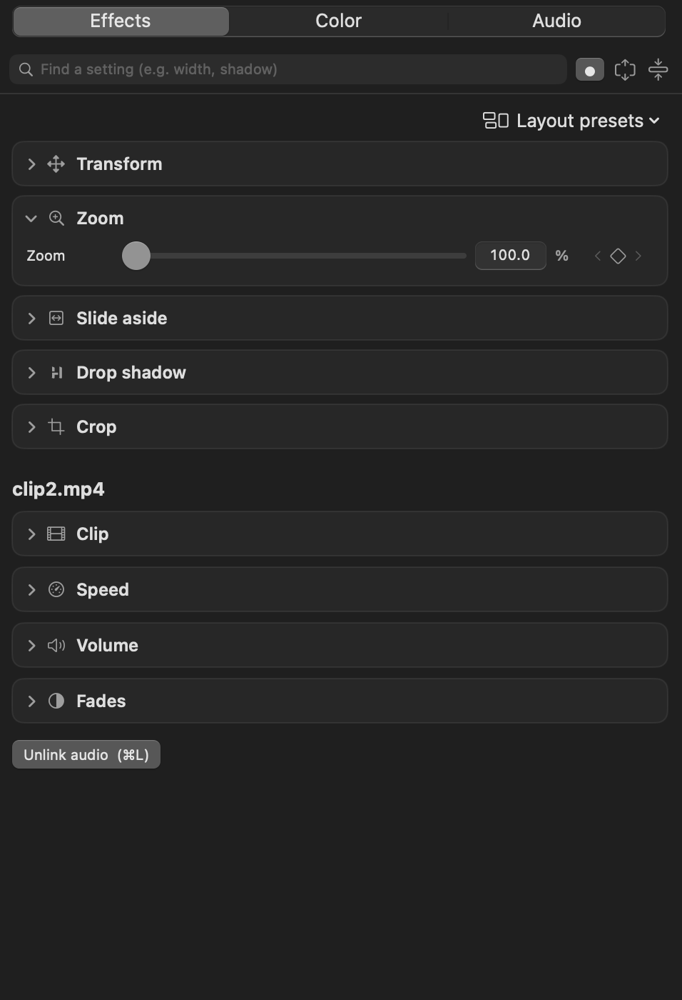

# Zoom in on the picture

**Zoom** pushes in on the picture, like moving the camera closer. Unlike Scale, the picture always fills the frame,
so you never see black edges.

1. Select a clip on the main track (V1).
2. In the **Effects** tab, find **Zoom**.
3. Drag the **Zoom** slider.

To make the zoom **move** over time (a slow push-in), use keyframes: see
[Keyframes: make things change over time](05-keyframes.mdx).

## Next

[Crop the edges →](03-crop.mdx)
