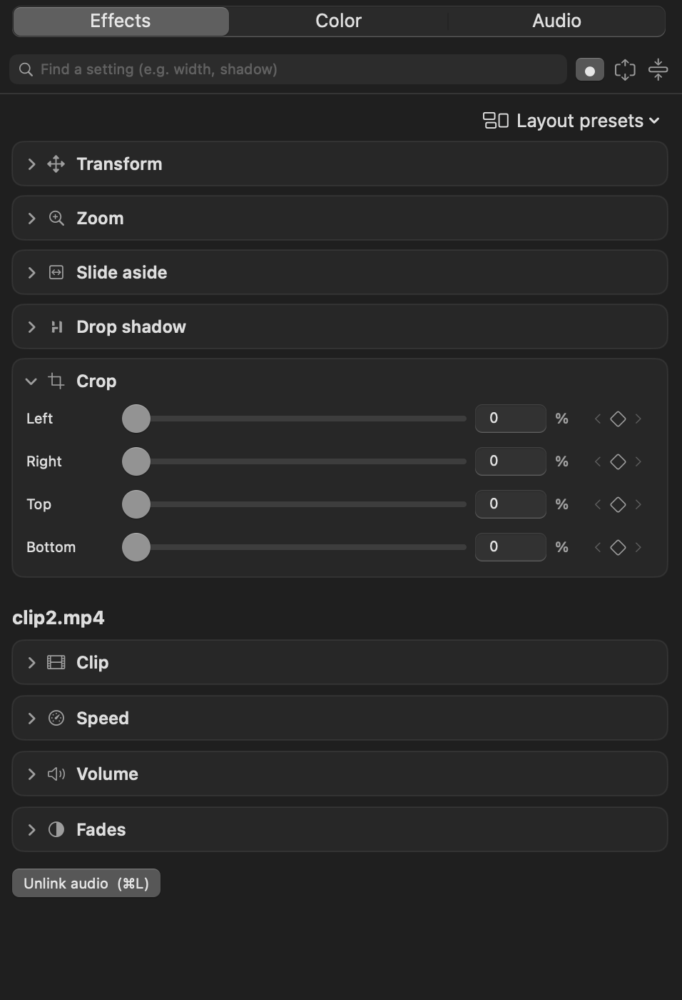

# Crop the edges

**Crop** cuts away the edges of a clip, for example to hide a microphone at the edge of the shot.

1. Select the clip.
2. In the **Effects** tab, open **Crop**.
3. Drag the left, right, top and bottom sliders.

On the main track the cropped edges show black. If you want the picture to fill the frame again, use
[Zoom](02-zoom.mdx) instead, or add a little Zoom after cropping.

## Next

[Picture in picture →](04-picture-in-picture.mdx)
