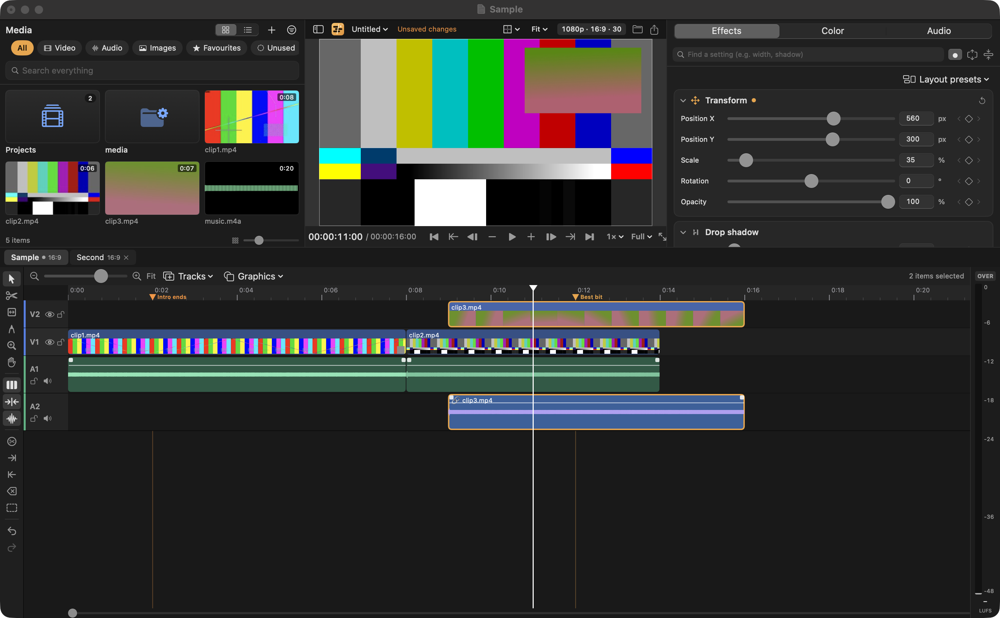

# Picture in picture

**Picture in picture** means a small video shown on top of the main one, for example your face in a corner of a
screen recording.

1. Put the main video on the main track (**V1**).
2. Put the second video on the track above (**V2**). Drag it there from the media panel, or use
   **Tracks ▸ Add video to a new track (V2+) at playhead…** above the timeline.
3. Select the V2 clip. In the **Effects** tab, click **Layout presets** and pick one:
   - **Bottom right, 35 %** or **Top right, 35 %**: a small corner window.
   - **Left half** or **Right half**: side by side.
   - **Full frame**: back to full size.
4. Fine-tune with **Transform**, add **Round Corners** or a **Drop shadow** to make it stand out.

**Slide aside** does the opposite: it moves the *main* picture over, so a panel or text can sit beside it.

## Next

[Keyframes: make things change over time →](05-keyframes.mdx)
