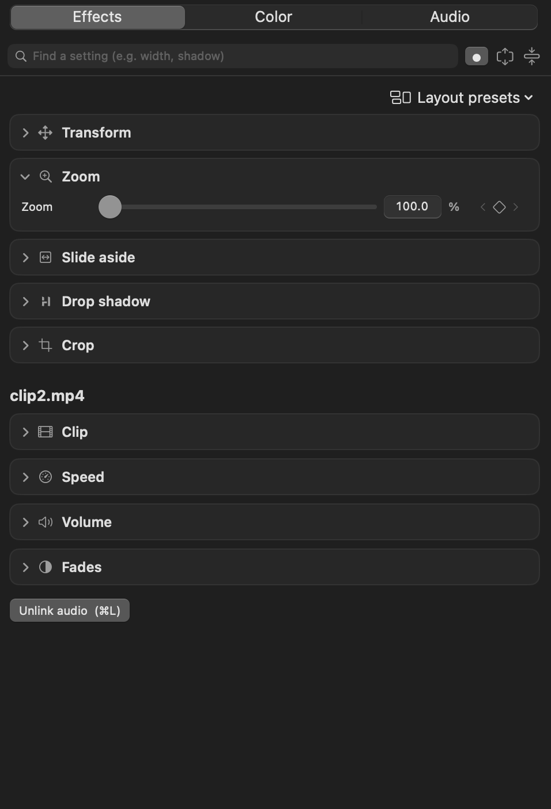

# Keyframes: make things change over time

A **keyframe** stores a value at one moment. Put two keyframes with different values, and Cutgenie moves smoothly
from one to the other. This is how you make a slow zoom, a sliding picture or a fade.

**Make a slow zoom-in:**

1. Select the clip and move the playhead to where the zoom should start.
2. In **Zoom**, click the small ◇ diamond. It turns solid: a keyframe is set.
3. Move the playhead later, to where the zoom should end.
4. Drag the **Zoom** slider. A second keyframe is added for you.

Play it back: the picture now zooms in between the two points.

- The **‹** and **›** arrows next to the diamond jump to the previous and next keyframe.
- With the playhead on a keyframe, click the solid diamond to delete it.
- **Easing** sets how the move starts and stops: steady (linear), or gently speeding up and slowing down.
  Right-click a diamond to choose.
- The **Keyframes** section lists everything that is keyframed on the clip.
- For exact control, open the **graph editor** (⇧⌘G) and drag the curves.

## Next

[Adjustment layers →](06-adjustment-layer.mdx)
