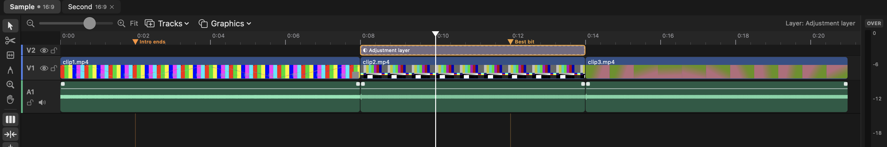

# Adjustment layers

An **adjustment layer** is an empty clip that sits on a track above other clips. Any effect or colour you put on it
changes everything underneath, for as long as it lasts.

1. Select the clips you want to change, or move the playhead to the spot.
2. Above the timeline, click **Tracks ▸ Adjustment layer (over the selection or at the playhead)**.
3. Select the new adjustment layer and change its colour or effects.

Drag its ends to make it cover more or less. Delete it to remove the change.

## Next

[Copy effects to other clips →](07-copy-effects.mdx)
