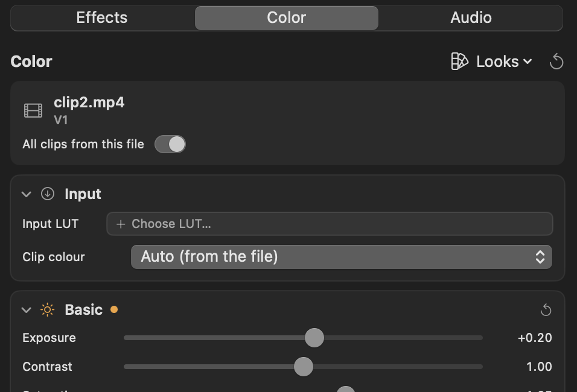

# Colour basics

**Colour correction** fixes the colour and brightness of a clip so it looks natural. **Grading** goes further and
gives it a style. Both happen in the **Color** tab of the inspector.

1. Select a clip.
2. Open the **Color** tab.
3. In **Basic**, drag the sliders:
   - **Exposure**: brighter or darker.
   - **Contrast**: more or less difference between dark and light parts.
   - **Saturation**: stronger or weaker colours. All the way down is black and white.
   - **Temperature**: warmer (orange) or cooler (blue).
   - **Tint**: more green or more magenta.
   - **Hue**: turns all the colours around the colour wheel.

A section that has been changed shows a reset arrow next to its title. Click it to go back to normal.

**Tip:** small changes look best. Compare by turning the change off and on.

## Next

[Colour wheels →](02-wheels.mdx)
