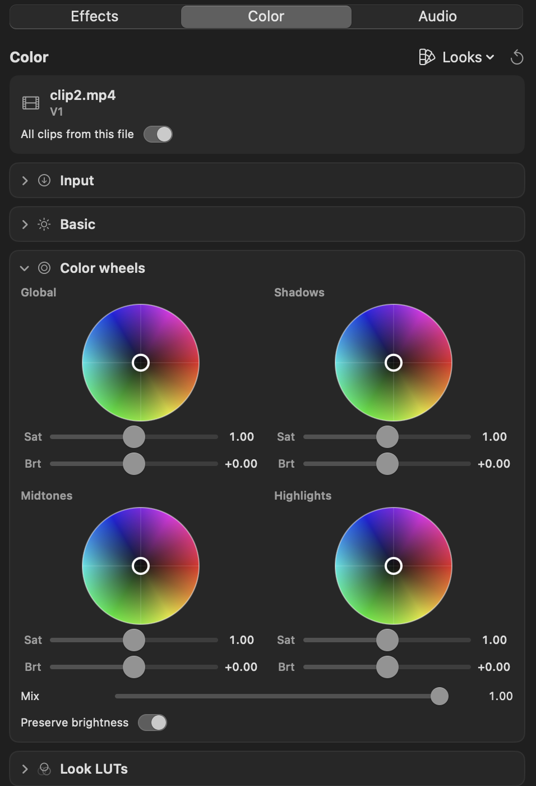

# Colour wheels

The **Color wheels** change colour in one part of the picture at a time:

- **Shadows**: the dark parts.
- **Midtones**: the middle, including most skin.
- **Highlights**: the bright parts, like the sky.
- **Global**: everything.

Drag the dot in a wheel towards a colour to add that colour. Click a wheel to reset it.

**Preserve brightness** (on by default) means the wheels only change colour, not how light or dark the picture is.
**Mix** sets how strongly all the wheels act.

A popular look: shadows a little blue, highlights a little orange.

## Next

[LUTs →](03-luts.mdx)
