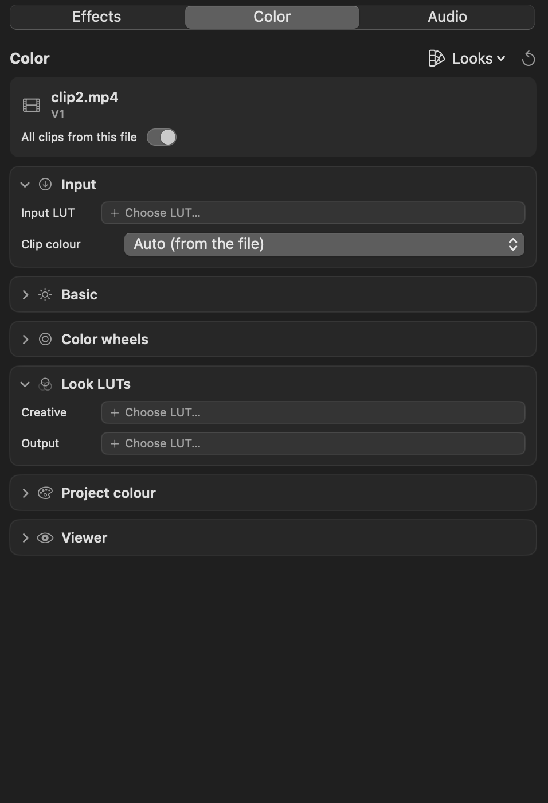

# LUTs

A **LUT** (look-up table, a `.cube` file) is a ready-made colour change.

**Input LUT, for log footage.** Some cameras film in *log*, which looks flat and grey. In **Input**, set the
**Input LUT** for the clip. **Auto (from the file)** picks one when the camera recorded it. Turn on
**All clips from this file** to apply it to every clip cut from the same video file.

**Look LUTs, for style.** In **Look LUTs**, add a `.cube` file to give the clip a film look. Use **Amount** to make it
weaker. The switch turns it off and on, and **Remove LUT** removes it.

LUTs never change your original video file.

## Next

[Make clips match →](04-match.mdx)
