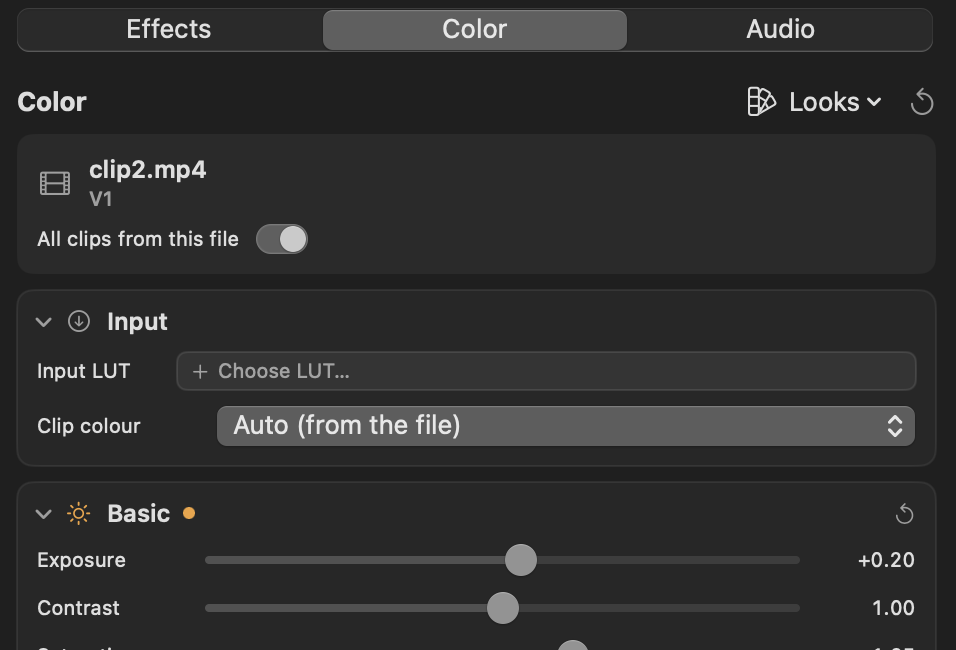

# Make clips match

Footage from two cameras rarely looks the same. To bring them closer:

1. Fix one clip first so it looks right. This is your *reference*.
2. Select the other clip.
3. Change **Temperature** and **Tint** until the whites and skin look the same, then **Exposure** and **Contrast**.

Play across the cut between the two clips. If you can't spot the change, you're done.

If you use the same settings on several clips, copy them: see [Save and reuse a look](05-looks.mdx).

## Next

[Save and reuse a look →](05-looks.mdx)
