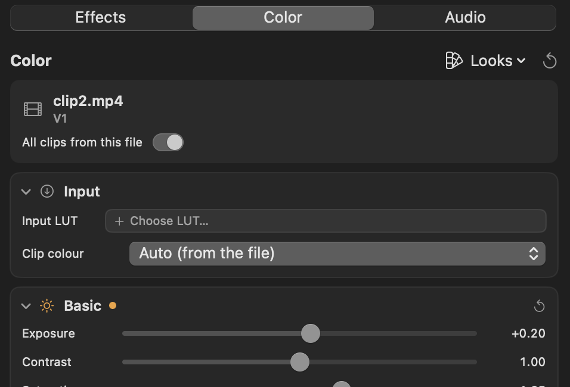

# Save and reuse a look

A **grade** is all the colour settings on one clip.

**Copy to other clips in this project:**

1. Select the graded clip and click **Copy grade** in the Color tab.
2. Select the other clips and choose **Paste grade** (it says **Paste grade to 3 selected clips** when you pick several).

**Save it as a look for any project:**

1. Select the graded clip.
2. Choose **Save this grade as a look…** and give it a name.
3. Later, select any clip and pick the look from **Looks**.

Delete a look you no longer need with **Delete look**.

To undo all colour on a clip, use **Reset basic and wheels to neutral**. LUTs stay; remove them separately.

## Next

[Add text →](../08-graphics/01-add-text.mdx)
