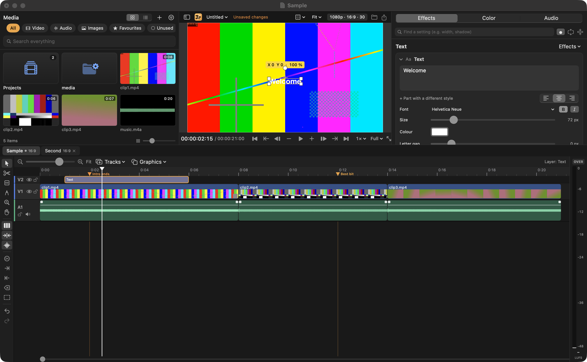

# Add text

1. Move the playhead to where the text should appear.
2. Press **⌃T**, or click **Graphics ▸ Text** above the timeline.

A text layer saying *Your text* appears on a track above your video, five seconds long.

3. Select it and type your words in the **Text** box in the inspector.
4. Drag the text in the viewer to move it. Drag the ends of the layer on the timeline to make it last longer or
   shorter.

## Next

[Style text →](02-style-text.mdx)
