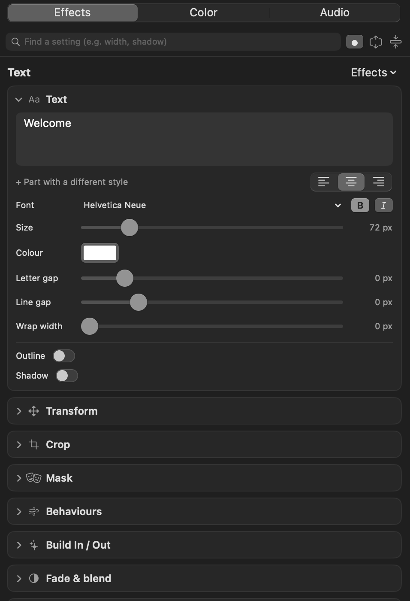

# Style text

Select a text layer. The inspector shows its settings:

- **Font** and size, bold and italic.
- **Colour**.
- **Outline**: a line around each letter. Helps text stay readable on busy pictures.
- **Shadow**: a soft shadow behind the letters.

**Two styles in one title:** click **+ Part with a different style** to add a second part, for example a big bold
name and a smaller job title underneath. Each part has its own font and colour. **Remove this part** deletes it.

## Next

[Animate text →](03-animate-text.mdx)
