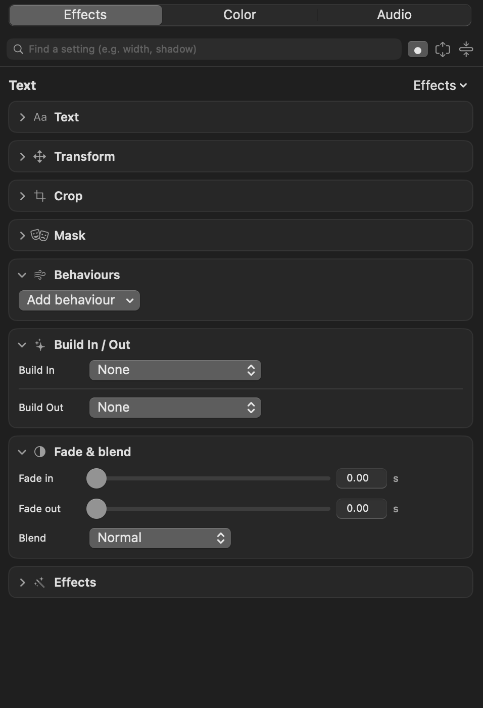

# Animate text

Select a text layer and open the **Effects** tab.

**Build In / Out** animates the text as it appears and disappears:

- **slide** in from a side (left, right, up or down),
- **typewriter**: letter by letter,
- **words**: word by word,
- **blur** or **scale**.

Set **Length** to choose how long the animation takes.

**Fade & blend** fades the whole layer in and out (in seconds).

**Behaviours** keep it moving the whole time: **drift**, **pulse** or **wiggle**. Set the **Speed** and **Amount**.

## Next

[Shapes →](04-shapes.mdx)
