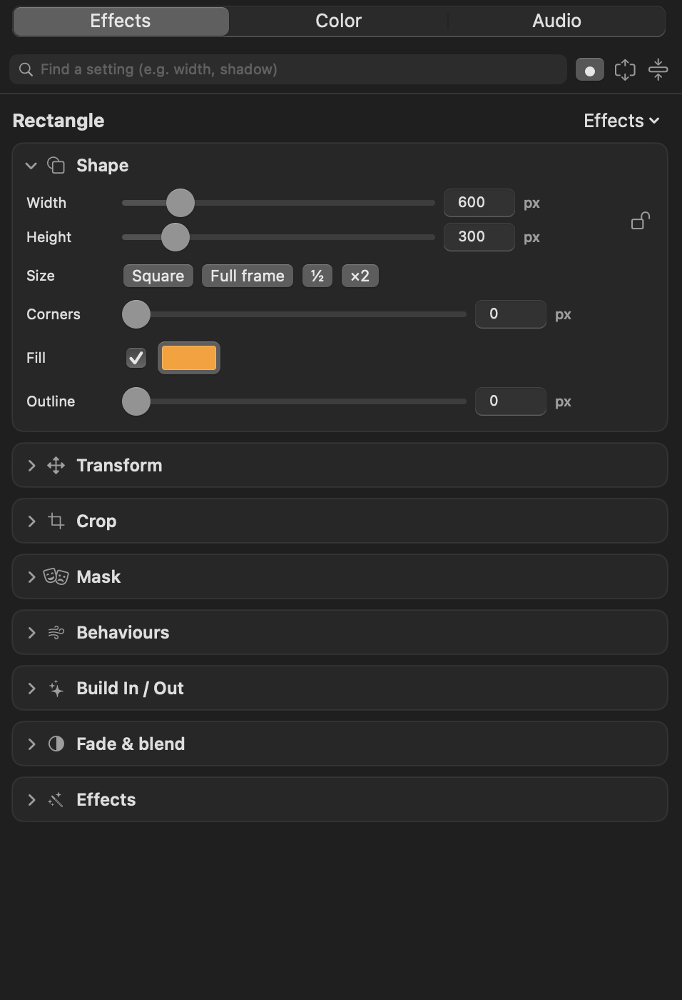

# Shapes

Click **Graphics** above the timeline and pick a shape:

- **Rectangle** and **Circle**: for boxes behind text, or to point at something.
- **Line**: for underlines and dividers.
- **Solid colour** and **Gradient**: a full background of colour.

Select the shape to change it. In **Shape**:

- **Width** and **Height** (click the lock to keep their proportions).
- **Square**, **Full frame**, **½** and **×2** for quick sizes.
- **Corners** rounds a rectangle.
- **Fill** sets its colour. A gradient has two colours and an **Angle**.

Shapes can be animated just like text: see [Animate text](03-animate-text.mdx).

## Next

[Layer effects →](05-effects.mdx)
