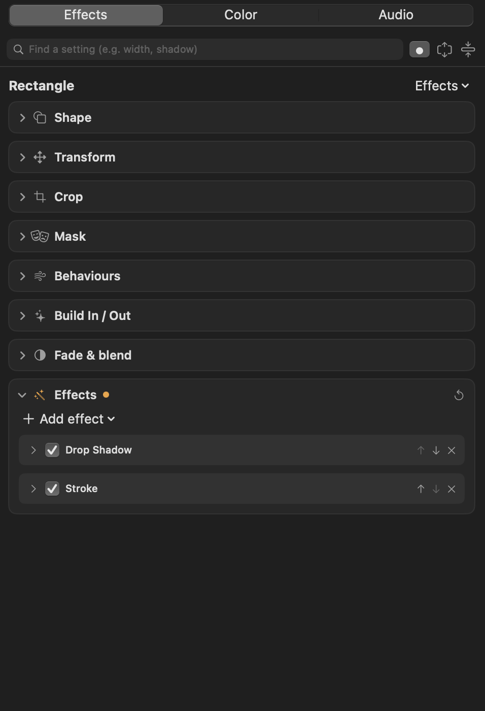

# Layer effects

In the **Effects** tab of a text, shape or picture-in-picture layer, click **Add effect**:

- **Drop Shadow**: a shadow behind it.
- **Outer Glow**: a soft light around it.
- **Stroke**: an outline.
- **Round Corners**.
- **Gaussian Blur**: blurs the layer.
- **Color Adjust**: brightness, contrast and saturation.
- **Tint**: colours it.

You can stack several. The arrows move an effect up or down: effects higher in the list are applied first.
**Remove effect** deletes one.

## Next

[Hide something with a blur →](06-blur-area.mdx)
