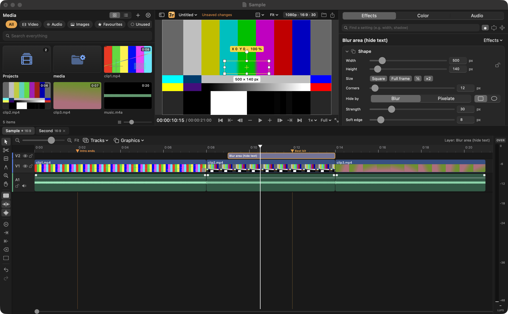

# Hide something with a blur

1. Move the playhead to where the thing to hide appears.
2. Click **Graphics ▸ Blur area (hide text)** above the timeline.
3. Drag the box in the viewer over what you want to hide. Resize it with its handles.

In the inspector:

- **Hide by**: **Blur** or **Pixelate** (blocks).
- Rectangle or oval shape.
- **Strength** (or **Block size**) and **Soft edge**.

If the thing moves, add keyframes to the box's **Position** so it follows: see
[Keyframes](../06-picture/05-keyframes.mdx).

Always play the whole part back to check nothing slips out from under the blur.

## Next

[Save and reuse titles →](07-titles.mdx)
