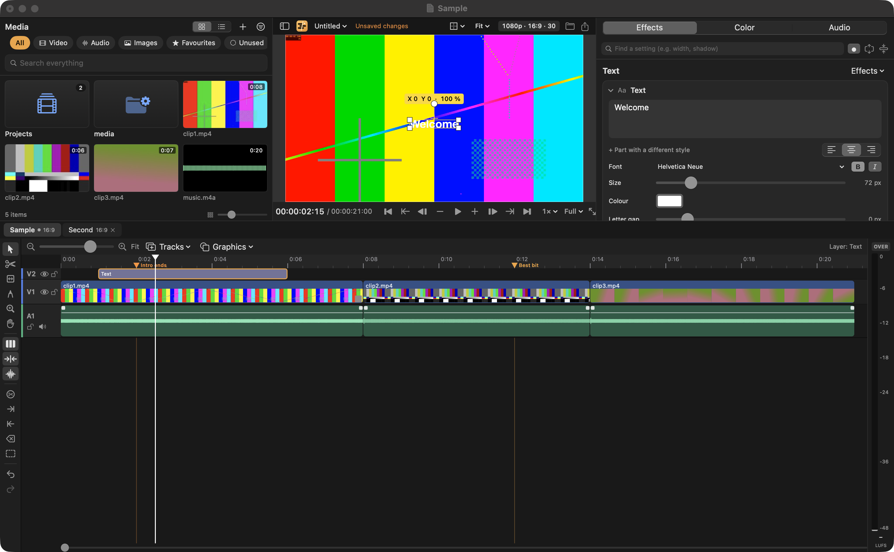

# Save and reuse titles

Made a lower third or title you like? Save it.

1. Select its text and shape layers (⌘-click to pick several).
2. Open the **Effects** menu at the top of the inspector and choose **Save as title…** and name it.

To use it again, move the playhead and choose **Graphics ▸ Add title** in the menu bar, then pick its name.
It arrives with the same look and animation. Change the words and you're done.

Remove a saved title with **Graphics ▸ Add title ▸ Delete title**.

## Next

[Change a clip's volume →](../09-sound/01-volume.mdx)
