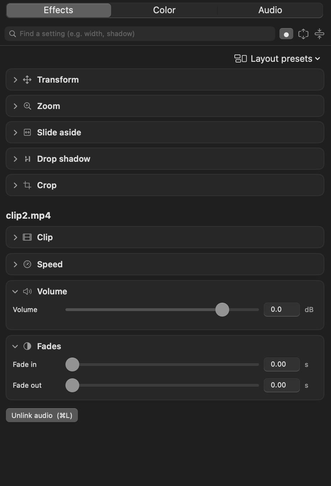

# Change a clip's volume

1. Select a clip.
2. In the **Effects** tab, find **Volume** and drag it. 100 % is the original level.

You can also drag the volume line across a sound clip on the timeline up or down. ⌥-click the line to add a
keyframe, so the volume can change partway through.

To change the sound of a whole track instead, use the **Audio** tab. See
[Clean up a voice](04-clean-voice.mdx).

## Next

[Fade sound in and out →](02-fades.mdx)
