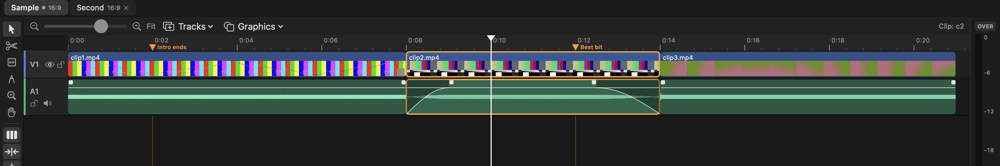

# Fade sound in and out

A **fade** makes sound start or end gently, instead of with a jump.

- On the timeline, drag the small squares at the top corners of a sound clip inwards.
- Or select the clip and set **Fade in** and **Fade out** in **Fades** in the Effects tab.

A short fade (a quarter of a second) removes clicks at cuts. A long fade (two or three seconds) is nice at the end of
music.

## Next

[Add music →](03-music.mdx)
