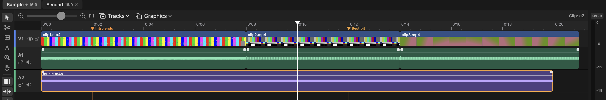

# Add music

1. Move the playhead to where the music should start.
2. Above the timeline, click **Tracks ▸ Import music / audio at playhead…** and choose the file.

The music goes on its own sound track, under your video. Then:

- Make it quieter so voices stay clear: select it and lower its **Volume**.
- Trim its end to where the video ends, and add a fade out: see [Fade sound in and out](02-fades.mdx).

Only use music you have the right to use.

## Next

[Clean up a voice →](04-clean-voice.mdx)
