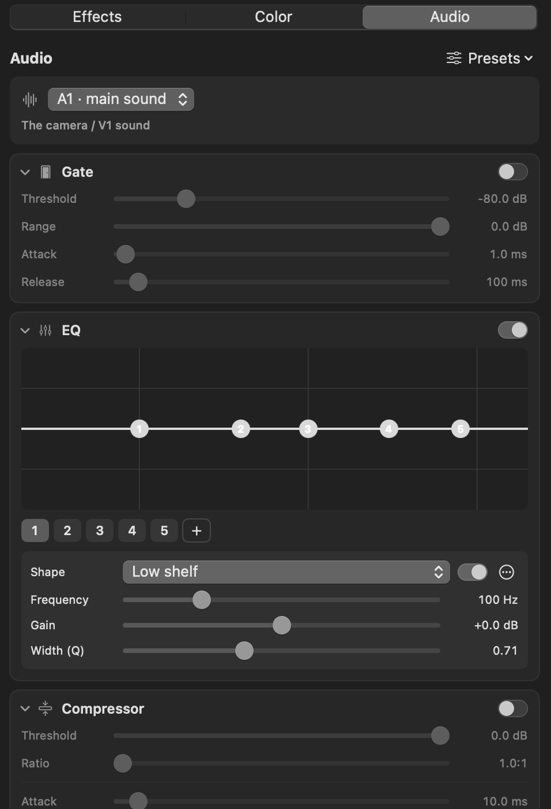
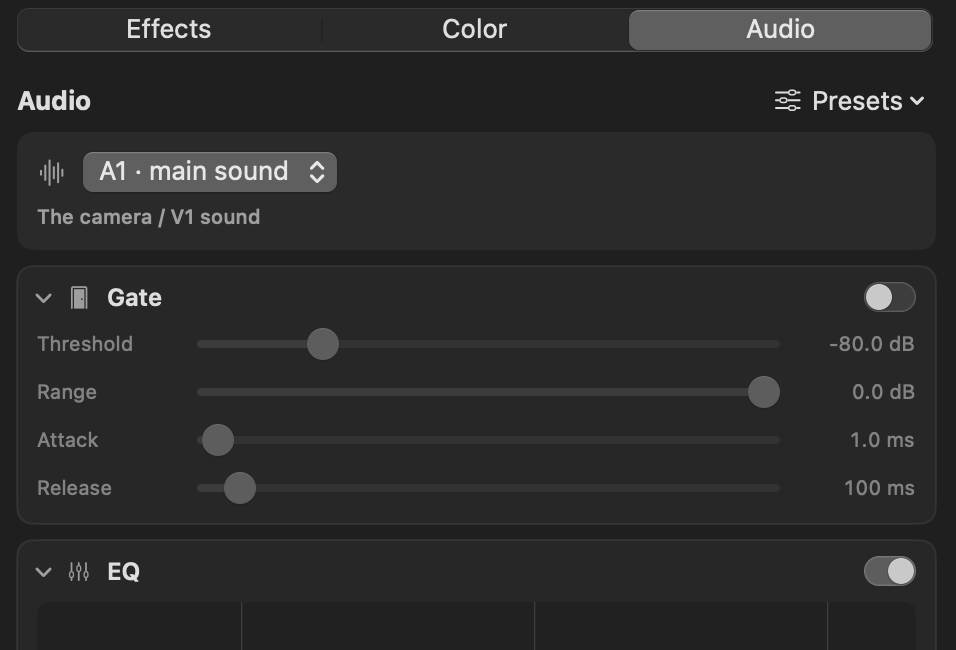

# Clean up a voice

The **Audio** tab works on a whole **track**. Pick the track from the menu at the top, for example **A1**.

The effects run in this order: **Gate → EQ → Compressor → Output gain → Limiter**. Turn each on with its switch.

- **Gate** goes quiet when no one is speaking, to hide background hiss and hum.
- **EQ** (equaliser) changes the sound's tone. Click **Add a band**, then drag it left or right to pick the pitch:
  - **High-pass** cuts low rumble (a good first step for voice).
  - **Bell** boosts or cuts around one pitch.
  - **Low shelf** and **High shelf** change all the low or high sounds.
  - **Notch** removes one exact pitch, such as an electrical hum.
- **Compressor** brings loud and quiet words closer together, so the voice is easier to follow.

Listen with headphones as you change things. Less is often better.

## Next

[Set the loudness →](05-loudness.mdx)
