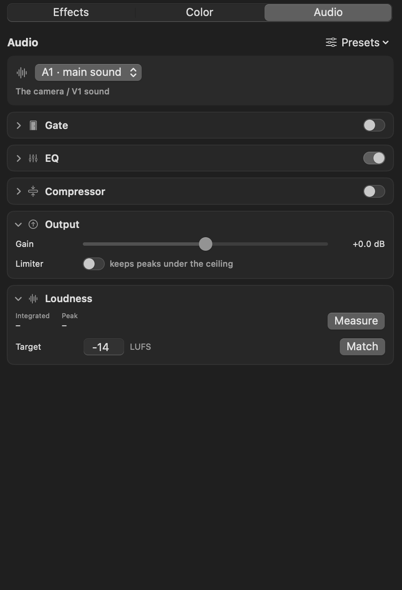

# Set the loudness

**Loudness** is how loud the whole video feels, measured in **LUFS**. YouTube and most sites aim for about
**−14 LUFS**.

1. Open the **Audio** tab and scroll to **Loudness**.
2. Click **Measure**. Cutgenie shows the **Integrated** loudness and the **Peak**.
3. Set **Target** (−14 is a good choice for YouTube) and click **Match**.

The **Limiter** in **Output** stops the loudest moments from going over the **Ceiling**, so the sound never
distorts. If the **OVER** light comes on, the sound clipped: lower the gain and click the light to clear it.

## Next

[Save audio settings →](06-presets.mdx)
