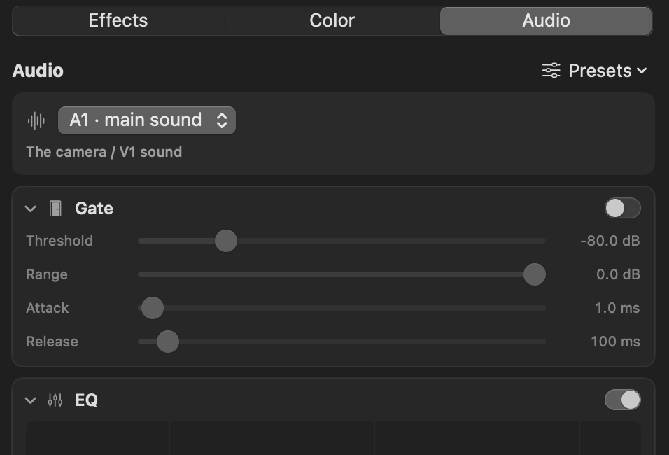

# Save audio settings

When a track sounds good, keep its settings:

1. In the **Audio** tab, open **Presets**.
2. Choose **Save … effects as a preset…** and name it, for example *My voice*.

In your next video, pick the preset to apply it. **Apply to all tracks** uses the same settings on every track.

Remove a preset with **Delete preset**.

## Next

[Export your video →](../10-exporting/01-export.mdx)
