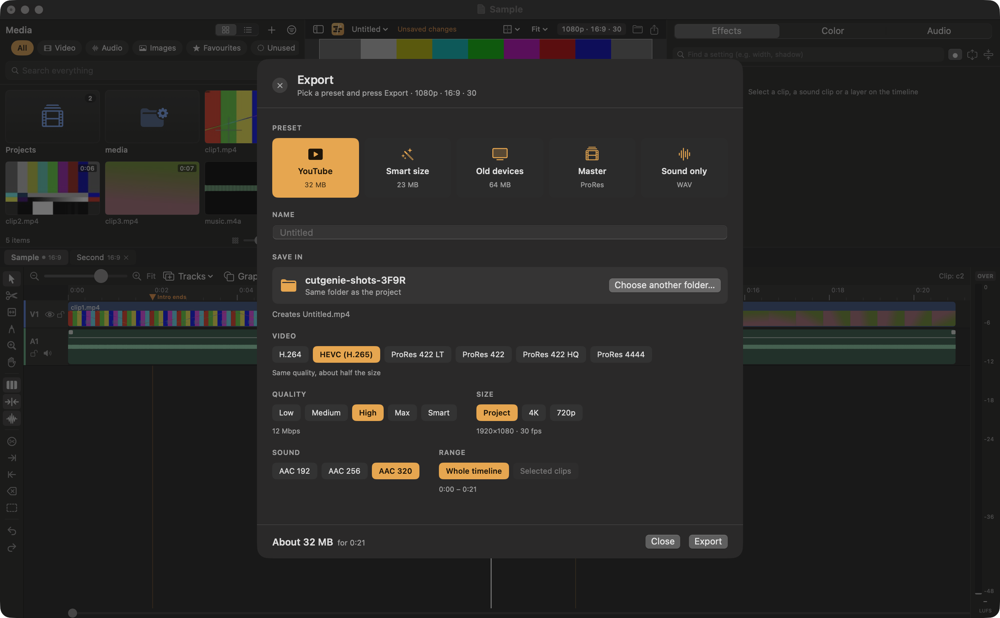

# Export your video

**Exporting** makes a normal video file from your project, ready to upload or send.

1. Press **⌘E**, or choose **Export…** in the project menu.
2. Pick a **Preset** (see [Which preset to use](02-presets.mdx)). **YouTube** is a good choice for most videos.
3. Check the **Name** and **Save in** folder.
4. Click **Export**.

A progress bar shows how far it is. You can close the window and **Keep editing**: the export carries on and its
progress shows above the viewer. When it's done, click **Show in Finder** to find the file.

Your project and original clips are not changed by exporting.

## Next

[Which preset to use →](02-presets.mdx)
