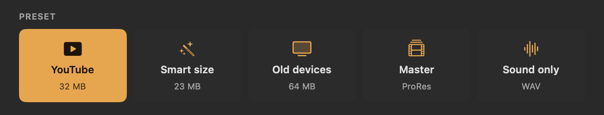

# Which preset to use

Each preset card shows how big the file will be.

| Preset | What it makes | Use it for |
| --- | --- | --- |
| **YouTube** | HEVC MP4, sharp | Uploading to YouTube and most sites |
| **Smart size** | HEVC MP4, smallest file | Sending or storing, same look |
| **Old devices** | H.264 MP4 | Older computers, phones and TVs |
| **Master** | ProRes 422 MOV | A top-quality copy to keep or edit again |
| **Sound only** | WAV | Just the sound, for a podcast or music |

**HEVC** and **H.264** are ways of compressing video. HEVC gives the same quality at about half the size. H.264
plays on almost anything. **ProRes** files are very large but lose almost nothing.

## Next

[Custom settings →](03-custom.mdx)
