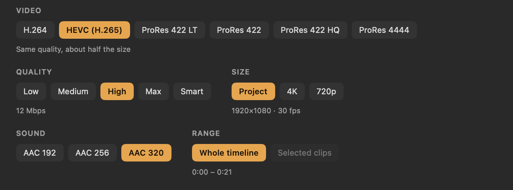

# Custom settings

Under the presets you can change each setting yourself:

- **Video**: H.264, HEVC (H.265), or one of the ProRes types.
- **Quality**: Low, Medium, High, Max, or **Smart** (same look as High, smallest file).
- **Size**: the project size, or a smaller one such as **1080p** or **720p**, or **4K**.
- **Sound**: AAC at 192, 256 or 320 (higher is better). A MOV file can also have **Uncompressed** sound.

The line under each setting tells you what you'll get, for example the size in pixels and the frame rate.

## Next

[Export just a part →](04-part.mdx)
